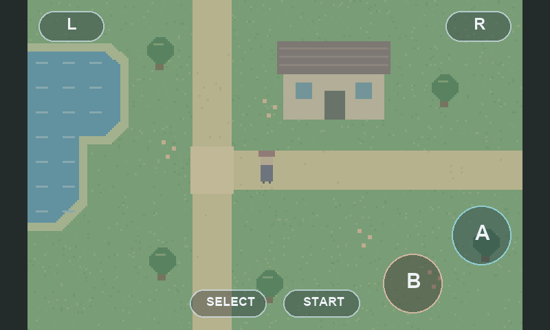

# K230 GBA 模拟器

在幻尔 Hiwonder K230 开发板上运行 mGBA 0.10.5 核心：800×480 触摸屏显示、实体摇杆方向输入、半透明 A/B/L/R/START/SELECT 六键、3.5mm 立体声音频和电池存档。按下摇杆可调出音量窗口，横向移动调节音量。

项目把模拟器编入 CanMV **用户态 RTAPP**，沿用匹配版本的厂商 RT-Smart 内核和显示驱动。现有板卡曾测得约 9.7 FPS；分段计时定位并优化后，连续 840 帧日志窗口为 60.1–60.2 FPS，接近 GBA 的 59.7275 Hz。实际表现随游戏场景、板型和固件版本变化，详见[验证记录](docs/validation.md)。



上图由实际 UI 绘图函数生成；背景是工具绘制的原创示意场景，并非游戏截图。

## 硬件与接线

当前验证配置为 Hiwonder K230（1 GiB 内存）、ST7701 800×480 触摸 LCD、TF 卡、HS-S34-L 模拟摇杆和 3.5mm 普通耳机。HDMI、其他屏幕及其他板型尚未完成验证。

断电接线，按开发板的 40PIN 实际编号定位：

| 摇杆标记 | 40PIN 物理脚 | 功能 |
|---|---|---|
| V | 1，3.3V | 摇杆供电 |
| G | 6，GND | 地 |
| X | 32，ADC0 | 左右方向、音量增减 |
| Y | 36，ADC1 | 上下方向 |
| K | 22，IO18 | 低电平按下，切换音量窗口 |

摇杆按 3.3V 供电。K 输入启用内部上拉，未连接时保持松开。当前实物配置保留 `JOY_INVERT_Y=True`；不同安装朝向可在 `src/gba_input.py` 中修改轴向、交换轴或死区。

## 使用

1. 准备与本项目匹配、包含内置 `gba` 模块和异步触摸支持的 CanMV 用户态固件。普通 CanMV 固件仅复制 Python 文件无法运行此模拟器；构建过程见[固件构建说明](docs/build.md)。
2. 自备合法取得的 GBA ROM，放到 TF 卡挂载根目录下的 `roms/`。默认入口使用 `/sdcard/roms/pokemon_emerald.gba`；其他文件名需同步修改 `src/main.py` 的 `ROM_PATH`、`SAVE_PATH` 和 `STATE_PATH`。
3. 将 `src/` 中四个 Python 文件复制到卡上 `/sdcard` 对应的挂载根目录，可使用下方部署工具。
4. 插卡并断电冷启动。`machine.reset()` 软复位不会重新执行此版本的 `main.py`。

```powershell
# Windows 示例，盘符按实际挂载修改；默认先检查，--write 才写入
python tools/deploy_gba_card.py --drive F:\ --write
```

```bash
# Linux 示例，路径是已挂载的 SDCARD 卷根目录
python3 tools/deploy_gba_card.py --drive /media/user/SDCARD --write
```

部署工具仅更新四个 Python 文件，备份旧版并回读核对；ROM、存档和裸区固件由用户另行管理。

- **方向**：实体摇杆上下左右。
- **游戏按键**：屏幕上半透明的 A、B、L、R、START、SELECT；布局与触摸判定共用 `gba_ui.py`。
- **音量**：按下摇杆 K 打开窗口；X 正方向增加、负方向降低，每步 5%，范围 0–100%。持续横推 400 ms 后，每 150 ms 连调；再次按 K 关闭，约 2.5 秒无操作自动隐藏。调整作用于现有音频流。厂商音量 0% 仍有最低增益，并非硬件静音。
- **存档**：先使用游戏内保存。模拟器每 1800 帧（约 30 秒）及正常退出时写入 `.sav`。立即断电可能丢失最近未写盘进度；断电前观察 `/sdcard/gba_boot.log` 的保存记录。

## 源码目录

```text
src/                  四个板端 Python 文件
firmware/gba/         mGBA 核心、MicroPython 绑定与 RGB565 缩放器
firmware/touch/       厂商触摸基线、修改后的绑定、原生异步触摸线程
firmware/patches/     CanMV Makefile 集成补丁
firmware/source-pins.json    匹配 SDK 各组件提交
firmware/source-sha256.json  发布固件源码哈希
tools/                部署、原生安装、宿主测试、RTAPP 打包校验
docs/                 构建、实现说明与验证记录
LICENSES/             第三方许可证全文
.github/workflows/    无需 ROM 的宿主验证
```

此仓库发布源码、测试及构建工具，未包含预编译固件、整卡镜像、私有原厂 BIOS、游戏 ROM 或用户存档。核心自带 mGBA 的开源 HLE BIOS 替代实现及其汇编源码。

## 开发与验证

Python 3.10+，原生测试另需 Linux/WSL、GCC 和 pthread；UI 预览可选安装 Pillow。

```bash
python3 tools/verify_all.py
# 使用仓库外的本地 ROM 做核心测试；无需拷入本仓库
python3 tools/verify_all.py --rom /path/to/pokemon_emerald.gba
# 如卡已挂载，可同时检查部署文件
python3 tools/verify_all.py --drive /media/user/SDCARD
```

未提供 ROM、卡或固件产物时，相应检查会明确标为 `SKIP`；宿主通过不代表已完成新硬件的显示、试听或跨断电存档验收。核心测试中的上游 UBSan 诊断会保留在日志中，见[验证记录](docs/validation.md)。

实现细节和本版本的 API 契约见[源码说明](docs/vendor-gba-source-review-2026-10-10.md)。反馈问题时请附板型、固件提交、接线及相关启动日志，勿上传 ROM 或存档。

## 许可证

原创集成代码、Python、工具和文档采用 [MIT](LICENSE)。mGBA 主体采用 MPL-2.0，blip_buf 采用 LGPL-2.1-or-later，厂商触摸绑定采用 BSD-2-Clause，其他组件保留各自条款。完整范围、来源及二进制分发要求见 [THIRD_PARTY_NOTICES.md](THIRD_PARTY_NOTICES.md)。
